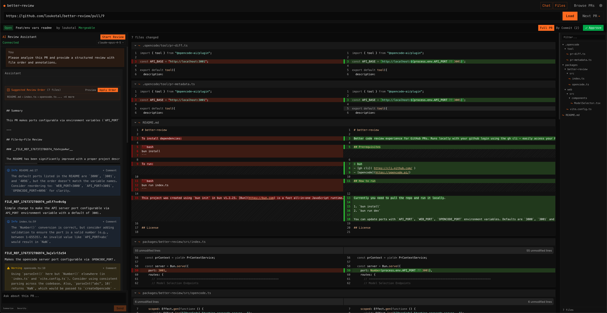

<p align="center">
  
</p>

Better Review is a local-first GitHub pull-request review app. It combines a focused diff viewer,
GitHub review actions, AI-assisted review, and browser-based approval flows for coding agents.



## Features

- Open any GitHub pull request available to your authenticated `gh` account.
- Browse assigned pull requests and review a full PR or an individual commit.
- Read, write, and manage GitHub comments and submit reviews.
- Switch between the exact **Original** diff and an on-demand, read-only **Reading** view with
  program-design, blast-radius, review-focus, and unknowns analysis.
- Chat with the PR review agent using a selectable model and reasoning level.
- Run review-agent repository tools inside a network-disabled Microsandbox microVM with read-only
  access to the prepared checkout.
- Create browser review sessions from the `better-review` CLI for plans, messages, and local diffs.
- Keep application state, prepared worktrees, caches, and review-session metadata on the host
  machine.

GitHub requests still go to GitHub, and AI prompts go to the model provider you select. The review
sandbox itself has no network access and receives no GitHub or model credentials.

## Prerequisites

- Node.js 24 or newer
- pnpm 11 or newer
- [GitHub CLI](https://cli.github.com/) authenticated with `gh auth login`
- Credentials for at least one supported AI provider

Better Review can use standard provider environment variables. For supported OAuth providers, it
can also reuse credentials from Pi or OpenCode's local credential store.

## Install and run

Install the JavaScript dependencies, then install the machine-local Microsandbox runtime once:

```sh
pnpm install
pnpm setup:microsandbox
```

`pnpm setup:microsandbox` is idempotent and only needs to succeed once per host machine. It installs
the sandbox runtime under `~/.microsandbox`. Better Review intentionally refuses to start without
it instead of falling back to running review-agent commands directly on the host.

Start the app:

```sh
pnpm start
```

Then open [http://localhost:3000](http://localhost:3000). The API listens on port `3001` by
default. `pnpm dev` is an equivalent alias.

For a production-style local build and server:

```sh
pnpm start:production
```

### Local API authentication

`pnpm start` (or `pnpm dev`) creates a gitignored `.better-review-api-token` and shares it with the
API and Vite client automatically.

For other setups, set `BETTER_REVIEW_API_TOKEN` on the API. Set
`VITE_BETTER_REVIEW_API_TOKEN` while building the web client to embed the same token, or enter it
when the browser prompts. `BETTER_REVIEW_DISABLE_API_AUTH=1` is intended only for temporary local
development.

### Ports and URLs

| Variable                | Default                 | Purpose                                                              |
| ----------------------- | ----------------------- | -------------------------------------------------------------------- |
| `WEB_PORT`              | `3000`                  | Vite development server                                              |
| `API_PORT`              | `3001`                  | Better Review API                                                    |
| `BETTER_REVIEW_API_URL` | `http://127.0.0.1:3001` | API URL used by the CLI or web proxy                                 |
| `BETTER_REVIEW_WEB_URL` | `http://127.0.0.1:3000` | Browser URL emitted by the CLI                                       |
| `OPENCODE_PORT`         | random free port        | Embedded compatibility runtime; set only when a fixed port is needed |

## Review sandbox

Each prepared PR worktree gets an isolated Microsandbox VM that can be reused across its review
conversations. The checkout and linked Git repository are mounted read-only. Each agent submission
gets fresh temporary scratch space.

The sandbox has:

- no network access;
- no host home-directory mount;
- no GitHub or model credentials;
- read-only access to the prepared PR checkout;
- bounded CPU, memory, command duration, VM lifetime, and idle time.

Better Review cleans up its orphaned VMs on startup and removes a worktree's VM when that worktree
is deleted.

## Agent Review CLI

Keep Better Review running, then invoke the workspace CLI directly:

```sh
pnpm exec tsx index.ts plan < plan.md
pnpm exec tsx index.ts last --file message.md
pnpm exec tsx index.ts review
pnpm exec tsx index.ts open-session <session-id>
```

The CLI creates or opens a browser session at `/agent-review/:sessionId`, waits for approval or a
request for changes, and writes structured JSON to stdout. The result includes
`feedbackMarkdown` and an `agentMessage` ready to return to the calling agent.

Diff reviews default to branch commits plus staged and unstaged changes, compared with the merge
base. Base detection prefers `origin/develop`, `develop`, then remote/local `main` and `master`.
Without a base, the default includes only uncommitted changes. Override with `--scope` or `--base`:

```sh
better-review review --scope staged
better-review review --scope uncommitted
better-review review --scope branch --base origin/develop
```

Scopes: `all` (default), `uncommitted`, `unstaged`, `staged`, `last-commit`, `branch`.
The review UI also lets you switch scopes.

### Install the local command

To expose `better-review` on this machine for other repositories and plugins:

```sh
./scripts/install-local-command.sh
```

The script installs a launcher at `~/.local/bin/better-review`. Ensure that directory is on your
`PATH`, then use the shorter commands:

```sh
better-review review
better-review plan < plan.md
```

### Pi integration

Install the global Pi extension and prompt templates:

```sh
./scripts/install-local-command.sh
./scripts/install-pi-integration.sh
```

Run `/reload` in an active Pi session. The integration adds the `submit_plan`,
`review_last_message`, and `review_working_diff` tools plus these prompts:

- `/better-review-plan`
- `/better-review-last`
- `/better-review-diff`

While a tool waits for human feedback, it displays the live review-session URL. It prefers
`BETTER_REVIEW_TAILSCALE_URL`, then the Tailscale URL registered for Better Review by Portless, so
the session can be opened from another device on the tailnet.

The source examples are in [`examples/`](./examples/).

### OpenCode integration examples

- [Plugin example](./examples/opencode-better-review-plugin.ts)
- [Plan review command](./examples/opencode-better-review-plan-command.md)
- [Last-message review command](./examples/opencode-better-review-last-command.md)
- [Local-diff review command](./examples/opencode-better-review-diff-command.md)

Copy the command files into `.opencode/commands/` in the repository where you want to use them and
rename them as desired.

## Development

Review sandboxes share VMs by checkout, with at most four distinct checkout VMs by default.
Idle VMs expire after five minutes; active submissions hold leases and cannot be evicted.
Use `BETTER_REVIEW_MICROSANDBOX_POOL_SIZE` and
`BETTER_REVIEW_MICROSANDBOX_IDLE_TIMEOUT_SECONDS` to adjust these limits.
Tool output is bounded while draining the command stream, and line-range reads happen inside the VM.
Chat streams share a cached projection and send ordered patches, with full snapshots on reconnect.

Set `BETTER_REVIEW_METRICS=1` to log timings and byte counts, or inspect the authenticated
`/api/review/metrics` endpoint for process-local aggregates (including recent p95 timings).
Run the real VM integration/measurement check with:

```sh
BETTER_REVIEW_SANDBOX_TEST=1 node --import tsx --test packages/better-review/src/review/microsandbox.integration.test.ts
```

```sh
pnpm test
pnpm lint
pnpm format:check
```

PR reviews run on Pi Durable through the normal `pnpm dev` / `pnpm start` workflow. The chat keeps
one conversation across PR revisions: **Pull latest & continue** updates the checkout and
revalidates earlier findings. Historical annotations open source at their original revision.
Closing a tab does not cancel a review; reconnecting restores committed progress. Interrupted
work resumes after the API restarts. **Compact context** summarizes older context while keeping
the full transcript in storage; automatic compaction is also enabled.

Persistent application data lives under `~/.local/share/better-review` by default. Pi conversations
use one SQLite database per review in `pi-reviews/`; prepared worktrees, repository caches, and
generated Reading-view reports also live under this directory. `BETTER_REVIEW_DATABASE_DIR`
overrides the conversation directory. A process lock prevents two API instances from owning the
same databases.

Existing review links and session IDs continue to work. On first open, the old conversation log
is imported read-only into Pi, including user messages, findings, tool observations and outcomes.
The old database is retained as a backup. An interrupted request from the retired runtime is
marked stopped; send a follow-up to continue it. No separate migration command is needed.

## License

Licensed under the [MIT License](./LICENSE).

## Acknowledgements

Built with [Pi Durable](https://github.com/earendil-works/pi/tree/main/packages/durable),
[OpenCode](https://opencode.ai/), [Effect](https://effect.website/),
[Diffs](https://diffs.com/), and [Solid](https://www.solidjs.com/).
