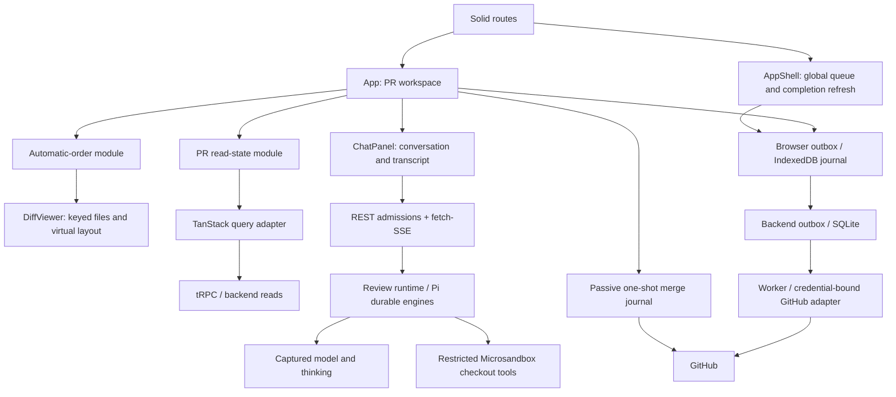

# Better Review: architecture and cleanup overview

Original assessment: `d8aa9f8` (2026-10-23). Original evidence and line references
remain below as a historical snapshot. Current owners, decisions and verification
appear in the [completion ledger](#completion-ledger).

Status: Astra cleared Stages 1–9, including the intentional Stage 8 non-extraction.
Stage 10 records the current contract and final gates for review; no commit/push is authorized.

## Summary

The original assessment prioritized duplicated interpretation and test plumbing over
mechanical file splitting. The approved work follows that scope.

The original priorities were model-test discovery, streaming races, shared parsing/test
helpers and confirmation authority. Those scoped changes and the source/adapter extractions
now have approval. Both worker-protocol and browser-to-durable-backend coverage now exist.
Retry-message presentation remains local: extraction failed the deletion test.

## Scope and method

- Inspect current production paths, test interfaces, and recent changes.
- Rank duplicated knowledge and fragile coordination, not file length.
- Distinguish repeated assertions at different seams from redundant tests at the same seam.
- Preserve delivery uncertainty, captured identity, source provenance, and manual review state.
- The original exploration ran no suites. The final verification section records current runs,
  separately from historical stage counts and targeted reruns.

No `GLOSSARY.md`, `AGENTS.md`, or ADR directory was found. Existing domain contracts live in
[`github-outbox-design.md`](github-outbox-design.md) and
[`review-admission-idempotency.md`](review-admission-idempotency.md).

## Inventory

Original snapshot inventory, retained for comparison, not current test totals:

| Source tree                  | TypeScript files | Test-named files | Total lines, including tests |
| ---------------------------- | ---------------: | ---------------: | ---------------------------: |
| `packages/web/src`           |              262 |               96 |                       53,107 |
| `packages/better-review/src` |              113 |               44 |                       34,298 |
| `packages/shared/src`        |               25 |                6 |                        1,922 |

Test-named means `.test.*` or `.browser.*`; counts are not executable test counts or coverage.
Size identifies places to inspect, not a reason to split a module.

## Contract documentation drift

**Resolved in Stage 10:** [the contract](github-outbox-design.md) now distinguishes
draft-stage dedup, archival, deadlines and acknowledgement generations. Original finding:

`docs/github-outbox-design.md:21–28` describes a general 60-second synced-content dedup window.
`packages/better-review/src/github-outbox/database.ts:267–268` explicitly excludes synced
draft-stage actions from that rule: external stage changes make historical success unsafe to reuse.
The overview should preserve that exception, and a future documentation cleanup should record it.

Queue deadlines, archived uncertainty, and per-submission approval acknowledgement fences also
need a discoverable explanation alongside the older outbox contract. This is documentation work,
not justification to flatten the distinct policies into a generic retry rule.

## Current architecture

### Ownership and lifetimes

The snapshot topology remains; extracted owners appear here and in the current test map below.
Treat the original line ranges as historical references, not current navigation anchors.

| Module                   | Owns                                                                        | Main paths                                                                                      |
| ------------------------ | --------------------------------------------------------------------------- | ----------------------------------------------------------------------------------------------- |
| Process composition      | HTTP authentication, runtime startup/shutdown, background work              | `packages/better-review/src/index.ts:154–226,1112–1184`                                         |
| Global browser shell     | Queue recovery, decisions, completion-driven refresh across routes          | `packages/web/src/AppShell.tsx:24–125`                                                          |
| PR workspace             | Selected PR, tabs, diff/revision state, manual position preservation        | `packages/web/src/App.tsx:132–601`                                                              |
| PR read state            | Selection/read epochs, retained display versus fresh write authority        | `packages/web/src/lib/pr-read-state.ts:5–115`                                                   |
| Query adapter            | Shared cache, request flights, persistence, post-write fencing              | `packages/web/src/lib/query.ts:32–175`                                                          |
| GitHub write lifecycle   | Browser admission, durable execution, aliases, recovery, uncertain delivery | `packages/web/src/lib/github-outbox.ts`; `packages/better-review/src/github-outbox/`            |
| Confirmation authority   | Receipt generations, read-start fences, approval/draft selection            | `packages/web/src/lib/github-confirmation-state.ts`; singleton in `lib/github-comment-views.ts` |
| Manual source resolution | Variant provenance, paired-content reads and fallback                       | `packages/better-review/src/manual-source-resolution.ts`; HTTP seam in `manual-source-route.ts` |
| Merge attempts           | Explicit single dispatch, passive recovery, no automatic retry              | `packages/better-review/src/gh/pr-merge.ts:72–212`                                              |
| AI review runtime        | Per-conversation engines, immutable admissions, stream channels             | `packages/better-review/src/review/runtime.ts:42–269`; `review/engine.ts:39–83`                 |
| Conversation UI          | Session lifecycle, model choice, questions, transcript, source links        | `packages/web/src/ChatPanel.tsx:132–790`                                                        |
| Diff presentation        | Mounted viewer workers, keyed file identity, virtual positions              | `packages/web/src/DiffViewer.tsx:95–178`                                                        |

CLI/manual review sessions are a separate flow from AI PR conversations: root `index.ts:42–76`
creates plan/message/local-diff sessions and opens the human review screen.

### Storage and authority

| Storage              | Content                                                                               | Important constraint                                                  |
| -------------------- | ------------------------------------------------------------------------------------- | --------------------------------------------------------------------- |
| Server SQLite        | Per-session AI conversations; GitHub outbox; merge attempts                           | Three distinct lifecycles, not one generic job queue                  |
| Server JSON          | App state and atomic `model-selection.json` preference                                | Preference differs from the effective model captured for an admission |
| Browser IndexedDB    | Query cache and review state; separate command/draft journal                          | Expiring cache must not govern durable write recovery                 |
| Browser localStorage | Layout/settings, order consumption, queue timeout, cached actor, merge intent/history | Cached identity/display data alone cannot authorize a GitHub write    |
| Microsandbox         | Read-only checkout/Git mounts and temporary scratch                                   | Credentials stay on host; sandbox network disabled                    |

API authentication wraps ordinary routes outside tRPC procedures; `publicProcedure` alone does
not imply an unauthenticated endpoint. GitHub authorization is separate: admission checks cached
numeric identity, while dispatch verifies live identity using the same credential snapshot as the write.

## Cleanup candidates

Original proposals and evidence follow. Status notes identify completed work; the
original wording is not a new backlog or authorization to change more code.

### 1. One review-token parser — Strong, low scope

**Resolved, Stage 2:** parser-owned rewriting serves clipboard export; see the owner/test map.

- **Evidence:** `ChatPanel.tsx:804–859` reparses annotation tokens, normalizes severity, and
  reproduces identity hashing for clipboard export. `utils/parseReviewTokens.ts:34–125` already
  owns those rules. Both paths are under `packages/web/src/`.
- **Change:** export feedback from the parsed transcript representation; preserve its current text format.
- **Depth / locality:** one grammar and identity implementation serves rendering and export.
- **Deletion test:** remove the second regex/normalization/hash implementation. Moving it intact to
  a new file does not count.
- **Test target:** one grammar contract plus export presentation cases. Preserve line ranges,
  severity defaults, dismissed annotations, and exact feedback formatting.

### 2. Confirmation authority owner — Strong, high scope

**Resolved, Stage 5:** one owner plus the independently reviewed head/cooldown correction.

- **Evidence:** `lib/github-comment-views.ts:23–113,233–269,353–409` maintains approval/stage maps,
  read serials, observed submissions, and retirement rules. `App.tsx:187–207,315–323` repeats
  actor/head selection; `components/PrDraftControl.tsx:26–68` also selects stage operations.
- **Change:** concentrate confirmed-action evidence and selection behind one module interface,
  retaining action-specific approval and stage policies.
- **Leverage:** controls consume an authoritative presentation state instead of rebuilding receipt selection.
- **Deletion test:** remove caller-side operation selection and duplicate evidence bookkeeping.
  Renaming or relocating the maps alone is insufficient.
- **Risk:** approval submission/alias generations, fresh negative reads, renewed requests, actor/head
  provenance, and stage reversals are distinct requirements. Do not unify their retirement rules blindly.
- **Test target:** existing approval-canonical, approval-settlement, and stage browser regressions
  remain essential. This refactor must replace duplicated orchestration tests, not those behaviors.

### 3. Manual-session source resolution — Strong, medium scope

**Resolved, Stage 6:** production resolver/HTTP seam, 47 injected-fake contracts and parity evidence.

- **Evidence:** `packages/better-review/src/index.ts:442–499,903–1027` mixes request handling,
  variant decoding, Git/index/worktree reads, precedence, and remote fallback. Paired Git reads recur
  at `963–969` and `992–999`.
- **Change:** a source-resolution module owns provenance and paired-content selection; HTTP stays at its adapter.
- **Locality:** source precedence and missing-content behavior become testable through one interface.
- **Deletion test:** remove repeated paired-read/fallback scaffolding from transport handlers.
- **Keep:** working-tree, staged, unstaged, and immutable Git sources are real alternatives.
  Keep immutable PR navigation in `source-navigation.ts` distinct unless evidence proves shared policy.

### 4. Retry presentation classification — Worth exploring, low scope

**Assessed, Stage 8:** intentional non-extraction; six outcomes still require six local wordings.

- **Evidence:** `AppShell.tsx:71–95` and `components/GithubOperationDetails.tsx:215–228` independently
  interpret retry facts into requested/running/failed/uncertain/confirmed messages.
- **Change:** share the interpretation where semantics match; retain compact versus detailed wording.
- **Deletion test:** remove a classification ladder and redundant feedback bookkeeping. Do not add
  another decision controller: that module was already deepened in `41e1907`.
- **Risk:** existing timeout/admission versus attempt priorities differ. Prove equivalence before sharing.

### 5. GitHub action-family facts — Worth exploring, medium scope

**Resolved, Stage 7:** private discriminated creation facts; independent worker validation retained.

- **Evidence:** `packages/better-review/src/github-outbox/github.ts:819–861,967–978,1070–1089`
  repeatedly classifies review/comment actions into endpoint and result families.
- **Change:** localize wire-family facts inside the GitHub adapter.
- **Leverage / locality:** adding an action should not require repeating the same endpoint-family decisions.
- **Deletion test:** remove repeated classification; merely splitting dispatch/reconcile/verification into
  files does not reduce complexity.
- **Keep:** dispatch, reconciliation, candidate verification, and independent worker validation require
  different evidence. Avoid a universal action registry across browser, worker, and merge.

## Existing depth worth keeping

Queue decision tracking, PR read state, automatic-order lifecycle, and model resolution were already
deepened in `41e1907`. Do not re-propose them as unfinished extraction work.

Keep immutable admission intent, uncertain-delivery handling, passive merge attempts, provenance
checks, sandbox restrictions, retained display versus write authority, and keyed diff identity.
Their branches express real domain differences. The renderer patch in `d8aa9f8` fixes stale virtual
positions after keyed moves; simplifying that lifecycle requires real-renderer evidence.

## Test audit

### What runs

The following counts describe the original snapshot. Current discovery is **164 browser
cases**, including seven model cases exactly once; final command results appear below.

- **Node:** 92 `*.test.ts` files, 640 textual `test`/`it` call sites: backend 44/367, web 42/257,
  shared 6/16. Parameterized loops make these unsuitable as executed-test counts.
- **Browser:** 54 fixture files, 147 discoverable exports. Navigation-mode expansion and the
  trusted-dismissal case produce **153 expected default cases**, subject to successful module loading.
- `browser-tests/harness.tsx:3–43` imports fixtures and selects `test*InBrowser` exports.
  `scripts/test-browser.mjs:43–60,200–275` uses fresh Chromium contexts, request isolation, page-error
  checks, 30-second limits, and special handling for reload sequences.
- `.github/workflows/checks.yml:18–28` runs Node, browser, transport, typechecks, and build.
  Root `pnpm test` alone excludes browser and transport; build alone runs no tests.
- Microsandbox integration tests require `BETTER_REVIEW_SANDBOX_TEST=1`, absent from CI:
  `review/microsandbox.integration.test.ts:14`, `review/structured-tools.integration.test.ts:17`.
- The original exploration did not rerun the three reported browser failures. Final
  verification records their current results by exact name, without waiving new failures.

### Confirmed gap: model browser checks bypass default discovery

**Resolved, Stage 1:** seven cases use the glob harness; standalone runner/HTML retired.

`packages/web/src/browser-tests/model-selection.browser.tsx:534–554` publishes
`window.runModelSelectionTests`, with seven private cases, rather than discoverable test exports.
`scripts/test-model-selection-browser.mjs:30–39` invokes it, but package scripts and CI do not.

**Proposed action:** register the seven existing cases individually in the default harness. Only
after that, retire the standalone runner/HTML. Keep the sequences: selection hydration, storage
failure, legacy migration, and intent capture through session creation are not replaced by backend
resolver tests. This is a registration gap, not seven missing test implementations.

### Confirmed test weakness: observer disposal hides stale callbacks

**Resolved, Stage 1:** fixtures retain disposed callbacks and deliver stale responses;
the hook fences same-session history against newer observations and pending requests.

`packages/web/src/hooks/useStreamingChat.test.ts:22–59,159–179` tests that old-session responses
cannot replace current chat, but its mock replaces the callback with a no-op on disposal.
It cannot independently prove rejection of an already-captured late callback.

`hooks/useStreamingChat.ts:235–267` also applies history after admission using session generation.
The inspected tests do not hold that history response while a newer same-session observation arrives.

**Proposed action:** preserve disposal coverage and add independently retained callbacks plus held
admission/history responses. Cover completion-before-receipt, newer observation-before-old-history,
and old-session success/error after selection changes. A production race is **suspected, not reproduced**.

The separate transport runner accepts arbitrary POST payloads, including raw `"mock reply"`
(`scripts/test-review-transport.mjs:88–96,171–194`). It proves socket availability under stream load,
not compatibility with actual server request decoding. Label that claim narrowly.

### Safe consolidation candidate: initial saved-order browser base case

**Resolved, Stage 4:** removed only the base wrapper after moving its unique assertions.
The retained painted initial-order case reports 30 assertions.

Both cases use the mounted-App seam and hold saved history before checking first order:

- `automatic-review-order.browser.tsx:169–170,266–408`:
  `testInitialSavedOrderNoFlickerInBrowser`.
- `review-order-rendering.browser.tsx:148–202`:
  `testInitialAutomaticOrderPaintedRowsInBrowser`.

The latter also checks visible shadow-DOM source rows over 20 frames. Move the older case's unique
one-session-creation and default-enabled assertions into it, then remove **only the base wrapper**.
Keep cached-core, commit, selected-session, timeout, retained-tab, live-completion, and navigation variants.

Manual, automatic, and unchanged-first-file renderer cases protect distinct reorder patterns. Keep all
three. Painted source text permits the production plain-line fallback and does not prove worker
highlighting completed. Stage 9A separately adds real worker completion and protocol-error coverage.

### Safe consolidation candidate: model setter rejection

**Resolved, Stage 4:** retained isolated persistence coverage and removed only the standalone
rejection case; model test fixtures use explicit environment isolation.

`model-selection.test.ts:28–44` rejects an unroutable `openai/gpt-5.5-pro` through `setSelectedModel`.
`model-selection-persistence.test.ts:8–20,72–75` repeats that public-seam assertion in a subprocess
and additionally proves persisted selection survives rejection.

Retain the isolated persistence assertion and remove the standalone rejection case. Keep catalog
search, the injected explicit/current credential-policy matrix, and runtime capture-before-await tests:
they exercise different contracts. Standardize fixture environment isolation before expanding these tests;
one persistence fixture inherits `process.env`, while another uses a restricted environment.

### High-leverage cleanup: browser test plumbing

**Resolved, Stage 3:** the entire browser glob shares counted checks/bounded waits, including
fixtures outside `browser-tests/`. Scenario setup and case-specific deadlines remain local.

The browser fixtures contain **51 local `check` helpers and 35 local `wait` helpers** with differing
deadlines, clocks, and assertion accounting. The harness trusts reported counts; several are constants.

Share assertion/wait primitives with explicit timeout choices and real assertion counting. This
removes duplication without deleting behavior tests. Avoid hiding scenario setup in an all-purpose
fixture that makes race ordering hard to read.

### Keep cross-seam regression coverage

| Apparently repeated coverage                                                                         | Why both matter                                                                                |
| ---------------------------------------------------------------------------------------------------- | ---------------------------------------------------------------------------------------------- |
| `github-outbox.test.ts:580–672` Clear/admission race and `github-queue-lifecycle.browser.ts:197–351` | Controlled journal adapter versus two real IndexedDB connections and reordered acknowledgement |
| `pr-read-state.test.ts:415–434` and `browser-tests/pr-read-state.browser.ts:18–88`                   | Owner event fencing versus actual QueryClient event filtering and HTTP request counts          |
| Backend model resolution and browser selection hydration                                             | Credential policy versus intent capture while UI/session state loads                           |
| Approval-canonical Changes and Overview cases                                                        | Different presentation paths consuming the same acknowledgement evidence                       |
| `pr-draft.browser.tsx:92–185` and backend `outbox.test.ts:104–141`                                   | Navigation/UI receipt authority versus worker completion after the last UI lease disappears    |

The in-memory journal (`lib/github-outbox.test.ts:195–303`) implements nontrivial alias/revision behavior.
Treat it as a controlled adapter, not evidence that IndexedDB transactions work. Keep real-store tests.

The original browser → backend composition gap now has Stage 9B coverage. It uses the production
outbox router/runtime and adapter, real HTTP/SuperJSON, IndexedDB and SQLite, with mocked GitHub
and unrelated PR readers. It does not exercise main-server auth or production PR-list decoding.

## Original recommended order

| Order | Work                                                                      | Expected gain                                           | Completion evidence                                                                               |
| ----- | ------------------------------------------------------------------------- | ------------------------------------------------------- | ------------------------------------------------------------------------------------------------- |
| 1     | Register existing model browser cases; strengthen streaming race fixtures | Close known gate gap and make lifecycle claims credible | Seven cases discovered by default; deliberately stale callbacks actually delivered                |
| 2     | Remove duplicate token parser; share test assertion/wait plumbing         | Low-risk locality and less maintenance                  | One token grammar; preserved export output; accurate assertion counts                             |
| 3     | Consolidate the two proven overlapping test cases                         | Smaller suite without losing behavior                   | Unique assertions moved first; renderer and persistence contracts still covered                   |
| 4     | Deepen confirmation authority                                             | Less caller knowledge across approval/stage controls    | Caller selection logic removed; alias-generation, provenance, and stale-read regressions retained |
| 5     | Extract manual source resolution; localize adapter action-family facts    | Less transport branching and repeated wire knowledge    | Precedence/evidence unchanged; repeated branch scaffolding deleted                                |
| 6     | Refresh contract docs and map test ownership                              | Prevent policy drift and future duplication             | Stage dedup, archive/deadline rules, and confirmation fences documented with their owning tests   |

Retry presentation consolidation is optional: attempt it only where the current compact/detailed
semantics genuinely match. No generic state-machine framework or universal action registry is proposed.

## Completion decisions

### Stage 8: retry presentation assessment (2026-10-23)

**Decision: retain both presentations; no production or test changes.**

Source comparison: `packages/web/src/AppShell.tsx:75–91` and
`packages/web/src/components/GithubOperationDetails.tsx:217–228` share this exact tail:

| Condition, in order               | Classification |
| --------------------------------- | -------------- |
| `!advanced`, regardless of status | requested      |
| advanced + queued/inflight        | retrying       |
| advanced + retry-failed           | failed         |
| advanced + uncertain              | unknown        |
| advanced + synced                 | confirmed      |
| advanced + any other status       | changed        |

The existing facts owner, `packages/web/src/lib/github-outbox-decisions.ts:26–35,109–118`,
already owns attempt advancement and observed status. A pure classifier beside it could name
these six outcomes, but each caller would still need six distinct wording mappings, including
its own failed-message formatter. Replacing each five-decision tail with a five-decision enum
switch would delete no caller decisions; label tables would instead add two six-entry mappings
and retain special failure formatting. That does not earn another interface here.

Shell must separately retain acknowledgement failure → timeout → admission error priority
before the tail. Details retains its independent control error alert (`231–233`), backend error
message/HTTP status → admission error fallback (`40–45`), and rejected-attempt fallback (`223`).
Shell's failure text instead uses only the optional HTTP status (`86`). These are intentional
presentation differences, not shared retry policy. No timers, acknowledgements, admission,
controls, subscriptions, wording, or HTTP fallbacks changed. Actual code deletion: zero.
No tests reran for that documentation-only decision. Astra subsequently cleared Stages 9A and 9B.

## Completion ledger

Stage evidence below is historical targeted evidence, not extra tests to add to final-suite totals.

| Stage | Outcome / review status                                                | Evidence                                                                                                                                                                  |
| ----- | ---------------------------------------------------------------------- | ------------------------------------------------------------------------------------------------------------------------------------------------------------------------- |
| 1     | Streaming races and model discovery; Astra clear                       | Retained stale callbacks, held same-session admission/history responses, seven model cases discovered once; transport smoke passed at this stage.                         |
| 2     | Shared token grammar and clipboard formatting; Astra clear             | `rewriteReviewTokens` replaces clipboard regex/identity duplication; grammar, text and actual clipboard tests retained.                                                   |
| 3     | Browser assertion/wait ownership across the glob; Astra clear          | 55 browser files, 155 exports / 161 discovered cases at closure; 158 passed, 2,743 successful-case assertions, three established failures.                                |
| 4     | Exactly two approved consolidations; Astra clear                       | Initial painted-order assertions 28 → 30; one wrapper removed. Model tests 26 → 25; persistence case retained. Discovery 161 → 160.                                       |
| 5     | Confirmation owner and App presentation correction; Astra clear        | 26 owner tests; 23-assertion actual-App head-A/cooldown/retry-UUID regression. Saved operations survive a newer detail head. Discovery returns to 161.                    |
| 6     | Manual source resolver and production-used HTTP seam; Astra clear      | 47 new fake contracts + 24 source-navigation tests = 71 passing; 516 differential route cases matched status/JSON/ordered calls.                                          |
| 7     | Private creation facts inside GitHub HTTP adapter; Astra clear         | 93 adapter / 193 combined adapter-worker tests. All six creation families; result kind, collection, event/state classification shared; explicit reply-root POST retained. |
| 8     | Intentional retry-presentation non-extraction; Astra clear             | Comparison above: no useful caller decision deletion; no production/test changes.                                                                                         |
| 9A    | Worker completion and protocol-error browser tests; Astra clear        | Two cases / 60 assertions. Discovery 161 → 163. Four retained renderer/reorder regressions also pass.                                                                     |
| 9B    | Actual-App durable HTTP composition; Astra clear                       | One case / 44 assertions, two real reloads: uncertain → read-confirmed → synced. Two fixture lifecycle tests; discovery 163 → 164.                                        |
| 10    | Current contract, completion map and final gates; submitted for review | Final command results and limitations below. No further production extraction or baseline fixes.                                                                          |

### Current owner / interface / test map

Paths below are relative to `packages/web/src/` unless prefixed with `backend:`.

| Owner / interface                                                                                                            | Callers and retained policy                                                                                                                                                                                                                                                    | Tests                                                                                                                                                         |
| ---------------------------------------------------------------------------------------------------------------------------- | ------------------------------------------------------------------------------------------------------------------------------------------------------------------------------------------------------------------------------------------------------------------------------ | ------------------------------------------------------------------------------------------------------------------------------------------------------------- |
| `hooks/useStreamingChat.ts`: existing hook/client interface                                                                  | Session generation, observation and pending-request fences; disposal still closes subscriptions.                                                                                                                                                                               | `hooks/useStreamingChat.test.ts`: held sends/history, completion-before-receipt, stale success/error callbacks; model browser cases preserve captured intent. |
| `utils/parseReviewTokens.ts`: `parseReviewTokens` / `rewriteReviewTokens`; `utils/feedback-text.ts`: `buildFeedbackText`     | Chat rendering and clipboard share grammar, severity and annotation identity; formatting/dismissal stay explicit.                                                                                                                                                              | `utils/{parseReviewTokens,feedback-text}.test.ts`; `browser-tests/feedback-copy.browser.tsx`.                                                                 |
| `browser-tests/assertions.ts`: `createAssertions(timeoutMs)` → `check`, `wait`, `result`                                     | Explicit finite deadlines, monotonic bounded polling; count successful checks and terminal wait success once. Harness rejects missing/invalid counts. Runner sums counts across reload phases, not fixed constants.                                                            | `browser-tests/assertions.test.ts`; all glob-discovered `*.browser.{ts,tsx}`, including component/diff/design-system fixtures.                                |
| `lib/github-confirmation-state.ts`: `observe`, `captureRead`, `acceptDetail`, `acceptStatus`, `approval`, `draft`            | `lib/github-comment-views.ts` owns the singleton lifetime; App and draft control consume centralized selection. Private request-start snapshots and acknowledged-alias generations; distinct approval/head versus draft/capability policies.                                   | `lib/github-confirmation-state.test.ts`; approval-canonical/settlement/status/head-cooldown and draft-intent browser fixtures; retained projection tests.     |
| `lib/github-pr-scope.ts`: `githubPrScope`                                                                                    | Pure canonical scope extraction shared without importing transport/store startup.                                                                                                                                                                                              | Confirmation and existing write/journal contracts exercise canonical scopes.                                                                                  |
| backend: `manual-source-resolution.ts`: `resolveManualSource(input, deps)`; `manual-source-route.ts`: `manualSourceResponse` | `index.ts` wires Effect/Git/file/remote readers. Matching explicit variant precedes parsed range; any available local side retains the entire local pair, including empty strings. HTTP decoding/status/error text stay at the seam. Immutable PR navigation remains separate. | `manual-source-{resolution,route}.test.ts`; existing `source-navigation.test.ts` and `trpc/routers/source-navigation.test.ts`.                                |
| backend: `github-outbox/github.ts`: private `creationActionFacts`                                                            | Dispatch/reconcile/verify and match/result helpers share creation families. Preflight, uncertainty, exact-wire review matching, deletion proof, draft permissions and synced enrichment remain distinct. Worker validation does not import these facts.                        | `github-outbox/github.test.ts`, `outbox.test.ts`, `runtime.test.ts`; candidate ID/body/head/actor negatives.                                                  |

### Worker and HTTP composition evidence

- [`diff/highlight-worker.browser.ts`](../packages/web/src/diff/highlight-worker.browser.ts)
  uses installed Pierre `FileDiff`/`WorkerPoolManager`, `poolSize: 1`, and the production
  module-worker entrypoint. Success correlates request ID, real result, callback/cache
  identity, exact source rows and differently colored TypeScript tokens. Failure replaces
  one matching real response with a valid error at `workerFactory`; it checks error delivery,
  no false success/cache, retained painted plain source, task cleanup and same-diff recovery.
  **Protocol injection is not a real worker crash.** Finally blocks terminate owned workers,
  remove listeners/DOM and assert zero workers/tasks/cache/subscriptions.
- [`browser-tests/github-http-composition.browser.tsx`](../packages/web/src/browser-tests/github-http-composition.browser.tsx)
  submits through the actual App editor and IndexedDB. The runner reverse-proxies exact
  outbox HTTP bytes to the production tRPC router/SuperJSON adapter in an env-isolated
  subprocess, with database path/fake credentials set before dynamic imports. Shared
  Effect layers stay lazy; the fixture does not need live infrastructure. The runtime
  owns SQLite admission and dispatch through the production GitHub adapter. Control IPC
  only holds/releases gates or inspects evidence, including read-only SQLite rows.
- Mock GitHub applies the held approval, loses its response, then holds the review-list
  reconciliation. The first reload retains uncertainty without resending; releasing the
  read confirms delivery and triggers one fresh list refresh. The second reload retains
  the synced receipt. Evidence: one admission, one attempt, one mutation POST, one review-list
  GET, stable UUID/actor 42/head/body across HTTP receipt, IndexedDB and SQLite.
- GitHub responses and unrelated PR/detail/list reads remain fixtures. The loopback server
  uses fixture-only bearer validation, not main-server auth middleware. This does not prove
  live GitHub behavior, production PR-list decoding, or exactly-once delivery in general.
  [`scripts/browser-github-http.test.mjs`](../scripts/browser-github-http.test.mjs) separately
  checks HTTP/auth/serialization and teardown while a mutation is held. The package Node
  globs do not include this script; final verification runs it explicitly. The browser
  composition case itself runs in default browser discovery.

### Sandbox integration prerequisites and limits

`review/microsandbox.integration.test.ts` and `review/structured-tools.integration.test.ts`
under `packages/better-review/src/` opt in only with `BETTER_REVIEW_SANDBOX_TEST=1`.
They require a working local Microsandbox runtime (`pnpm setup:microsandbox` calls
`ensureRuntime`), supported host virtualization, Git, writable fixture/cache storage,
and the configured/default container image. The implementation uses an anonymous registry
and a digest-pinned `alpine/git` image unless `BETTER_REVIEW_MICROSANDBOX_IMAGE` overrides it;
image/runtime setup may need downloads. Tests create local Git fixture histories/worktrees,
then use read-only Git/checkout mounts, temporary scratch and disabled guest networking.
They require neither a paid model call nor a GitHub write. This review did not provision
the runtime or run microVM integration; ordinary mocked sandbox tests are a separate seam.

### Final verification (Stage 10)

Each final command runs once. Logs and exit-status JSON live under
`artifacts/final-verification/`; full browser results/screenshots live under
`artifacts/browser/`. Earlier targeted runs and reload phases are not added again.

| Gate                                                             | Exit | Actual result / artifact                                                                                                                                                                                                             |
| ---------------------------------------------------------------- | ---- | ------------------------------------------------------------------------------------------------------------------------------------------------------------------------------------------------------------------------------------ |
| `pnpm test`                                                      | 0    | 869 tests: **867 pass, 2 skip, 0 fail**. Shared 16/16; backend 511 pass + 2 skips; web 340/340. `pnpm-test.log`.                                                                                                                     |
| `node --test scripts/browser-github-http.test.mjs`               | 0    | **2/2 pass**; separate from package globs. `fixture-lifecycle.log`.                                                                                                                                                                  |
| `pnpm test:browser`                                              | 1    | **162/164 pass**, **2,947 successful-case assertions**, two established failures below. 58 browser files / 158 exported cases; mode expansion and trusted dismissal make 164 cases. `browser.log`, `artifacts/browser/results.json`. |
| `pnpm exec tsc --noEmit -p packages/web/tsconfig.json`           | 0    | `web-typecheck.log`.                                                                                                                                                                                                                 |
| `pnpm exec tsc --noEmit -p packages/better-review/tsconfig.json` | 0    | `backend-typecheck.log`.                                                                                                                                                                                                             |
| `pnpm lint`                                                      | 0    | `lint.log`.                                                                                                                                                                                                                          |

| Additional gate     | Exit | Artifact                                                                |
| ------------------- | ---- | ----------------------------------------------------------------------- |
| `pnpm format:check` | 0    | `format-check.log`; no unrelated formatting failures or broad rewrites. |
| `git diff --check`  | 0    | `diff-check.log`.                                                       |

The two skipped tests are the opt-in microVM cases named in the sandbox section; no VM
provisioning occurred. The Node total includes nested subtests as reported by each package;
the standalone fixture lifecycle tests remain a separate row. Browser counts include the
44-assertion composition case once, with all three phase counts summed by the runner.
All seven model cases, both worker cases and all four retained renderer/order cases pass.

| Established browser baseline                                                  | Final result                                                                                                                                                                                      |
| ----------------------------------------------------------------------------- | ------------------------------------------------------------------------------------------------------------------------------------------------------------------------------------------------- |
| `testGithubOutboxInBrowser` (`../lib/github-outbox.browser.ts`)               | Fails: `same admission ID and payload replayed after reload`.                                                                                                                                     |
| `testRenewedApprovalCooldownInBrowser` (`./approval-cooldown.browser.tsx`)    | Fails: `Approval did not sync through production adapter`.                                                                                                                                        |
| `testAppGithubCommentProjectionInBrowser` (`./github-projection.browser.tsx`) | **Passes this run, 82 assertions.** Previously failed: `Sync refresh duplicated local and remote comment`. Keep the variable baseline visible; no unrelated fix or claim of permanent resolution. |

No new browser failures occurred. `test-counts.json` records this comparison and the final
composition evidence: one admission/attempt/POST/review-list GET; six snapshot and fourteen
pending HTTP reads; one completion-driven list refresh; stable actor/head/UUID; verified
subprocess/server/runtime/storage cleanup. Successful-case assertion totals exclude partial
assertions from failed cases.

Current failure screenshots: `artifacts/browser/29-failure.png` (outbox replay) and
`artifacts/browser/33-failure.png` (approval cooldown). Older artifact files are not
additional failures in this run.

The review-transport smoke passed in Stage 1. Its runner/server transport code did not change
in this cleanup, so it was not rerun or counted as a final gate. The smoke demonstrates socket
availability under stream load, not production admission decoding. No full build or opt-in
microVM integration is claimed by these command results.

### Final inventory and resource checks

Stage 10 changes only this overview and `docs/github-outbox-design.md`. The full uncommitted
worktree, including earlier approved work and the pre-existing overview, contains **95 paths:
74 modified, 2 deleted, 19 untracked**. `artifacts/final-verification/git-inventory.json`
lists each path/status; do not treat this as 95 new Stage 10 edits. HEAD remains
`d8aa9f81392bd6c5f11f6d37cdf660165b0e6165`; no commits or staged changes were created.

Package manifests, lockfile/workspace configuration, `patches/@pierre__diffs@1.2.0.patch`,
`packages/web/src/DiffViewer.tsx` and the production `diff/highlight-worker.ts` remain
unchanged. Existing patch/reorder lifetime behavior is preserved. Backend review transport
and its smoke runner also have no working-tree changes.

Worker cases assert listener/DOM removal and empty owned pool statistics before their browser
contexts close. The HTTP case and separate lifecycle tests verify gate release, runtime/SQLite
and server closure, subprocess exit and isolated-storage removal, including held-mutation
teardown. A post-run read-only process/temp-directory check found no HTTP fixture subprocesses
or HTTP/actions/nested-replies fixture directories. No user processes or storage were killed
or removed to obtain that result. Per-command `.status.json` files record exits and durations.

### Review and authorization

Stages 1–9 have Astra clearance. Stage 10 awaits review of these documents and final results;
this is not a claim of an all-green baseline or authorization to fix unrelated failures.
Preserve the existing Pierre renderer patch, dependency versions and other uncommitted work.
No agents, commits, branches, pushes, real GitHub writes or paid calls form part of this cleanup.
